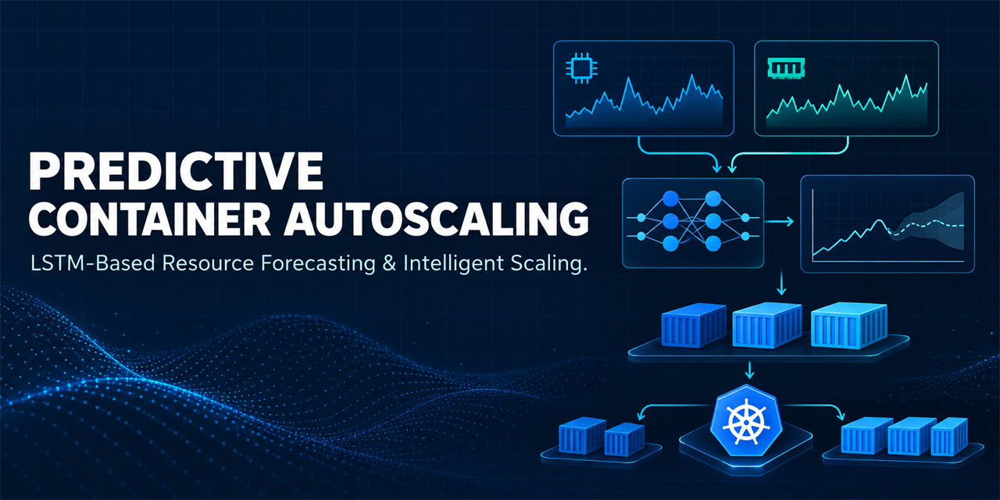
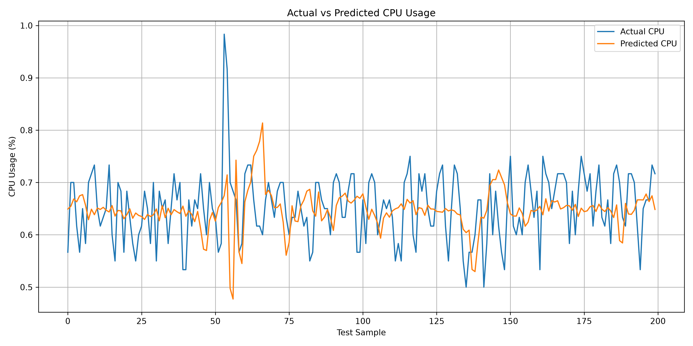
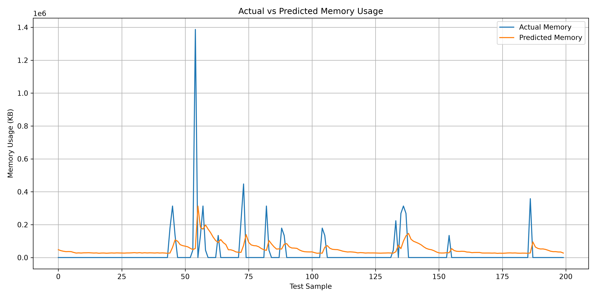
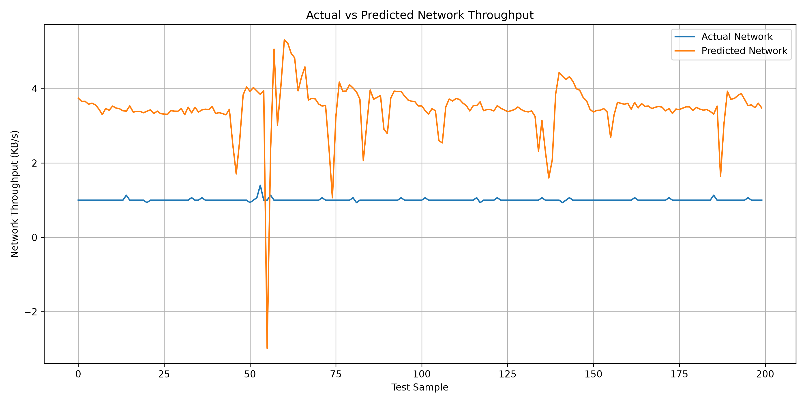
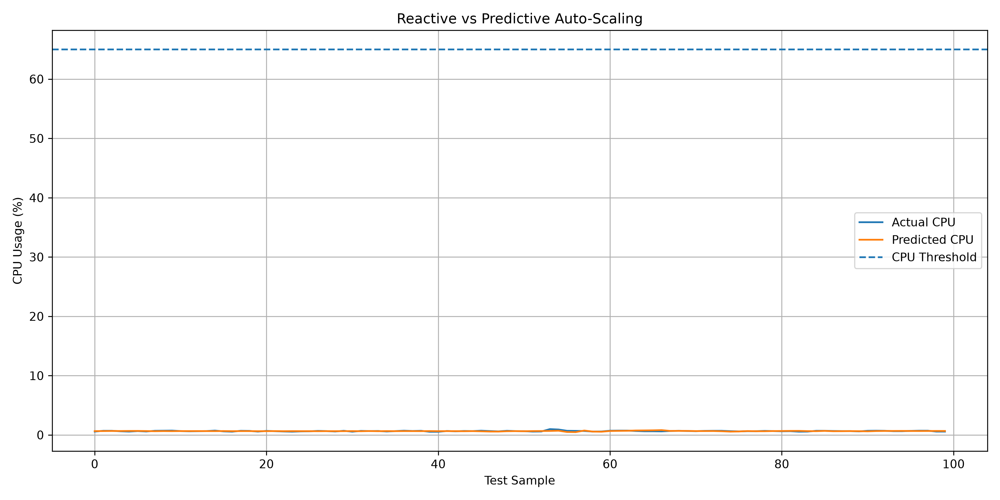
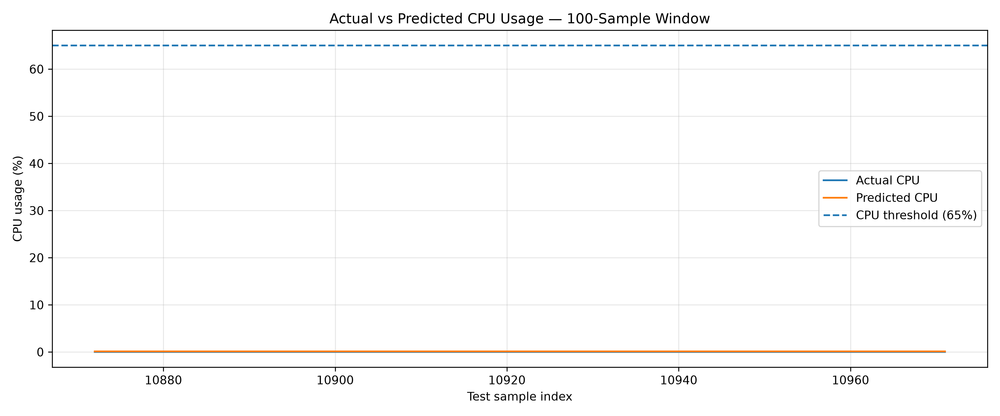
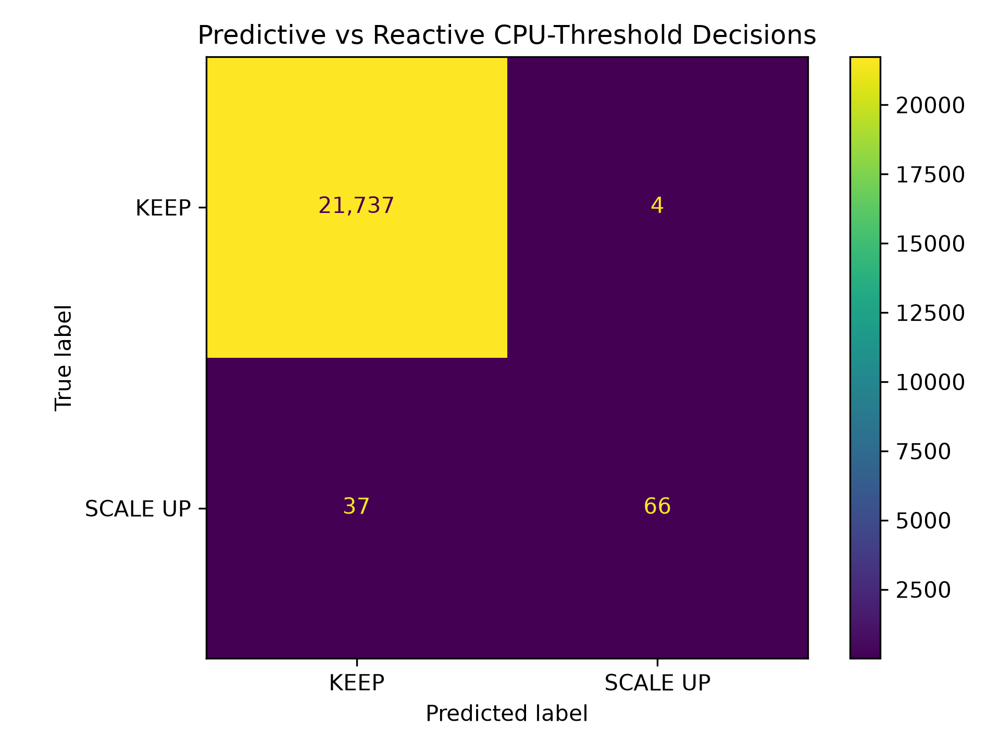

# Predictive Container Autoscaling Using LSTM and Kubernetes



This repository contains an experimental framework for forecasting CPU, memory, and network usage from historical workload traces and using predictions in a Kubernetes scaling prototype. The project separates offline model development from a manually invoked live monitoring and scaling workflow.

Traditional reactive scaling responds to observed resource pressure after it appears. Forecasting can provide an earlier signal, but a forecast alone does not guarantee a better scaling outcome. This project explores that idea with an LSTM model and records a separate offline comparison of CPU-threshold decisions. It is a research prototype, not a production-ready autoscaler.

## Project Objectives

- Prepare historical VM telemetry for multivariate, next-step forecasting.
- Train and evaluate an LSTM model for CPU, memory, and network measurements.
- Explore validation-window and Prometheus-fed model updates.
- Compare a simple reactive CPU threshold with the same threshold applied to predicted CPU values.
- Demonstrate a Kubernetes controller that queries Prometheus and can adjust a Deployment replica count.

## Key Features

The following functionality is present in the repository source and artifacts:

- **Multivariate LSTM forecasting:** one-step predictions for CPU, memory, and network from 12 prior observations.
- **Historical data pipeline:** combines the included raw Bitbrains CSV files, cleans required columns, and generates per-VM normalized sequences.
- **Model training and evaluation:** trains a Keras LSTM, saves best-checkpoint and final models, and calculates prediction errors on saved test sequences.
- **Experimental model updates:** `model/adaptive_update.py` fine-tunes on a selected validation-data window; `model/live_adaptive_update.py` contains a separate Prometheus-fed update experiment.
- **Reactive/predictive CPU rule comparison:** compares actual and predicted CPU against a 65% threshold and writes a decision table and graph.
- **Prometheus-backed scaling prototype:** `scaling/auto_scaler.py` queries recent CPU, memory, and network series, calculates weighted pressure, applies replica bounds, confirmation count, and cooldown, then invokes `kubectl scale` when its conditions are met.
- **Containerized sample service:** a small Flask application with `/` and `/health` endpoints, packaged by the included Dockerfile.
- **Kubernetes manifests:** a Deployment and NodePort Service for the sample Flask application.
- **Saved artifacts:** raw and cleaned data, processed NumPy arrays, scalers, Keras models, result CSVs, and generated graphs are included.

Prometheus and Kubernetes are external runtime requirements. This repository does not include a Prometheus scrape configuration or Grafana dashboard. The project does not implement a continuously running controller loop; the scaling script is invoked as a command.

## System Architecture

The diagram separates offline model development from the live prototype. The online scripts require a separately configured cluster and Prometheus server. The controller makes a scaling decision when run; the return arrow represents later workload metrics, not a continuously running feedback service.

```mermaid
flowchart LR
  subgraph OFFLINE["Offline model development"]
    RAW[("Bitbrains raw CSV files")]
    PRE["preprocess.py<br/>clean, combine, sort by VM and timestamp"]
    CLEAN[("dataset/clean_dataset.csv")]
    SEQ["prepare_sequences.py<br/>per-VM chronological split, train-only scaling,<br/>12-step sequence generation"]
    ARR[("X/y train, validation and test arrays")]
    TRAIN["train_lstm.py<br/>LSTM training"]
    BASE[("best_lstm.keras<br/>lstm_model.keras")]
    EVAL["evaluate_lstm.py<br/>test predictions and error metrics"]
    PRED[("test_predictions.csv")]
    OFFADAPT["adaptive_update.py<br/>validation-window fine-tuning"]
    OFFMODEL[("adaptive_lstm.keras")]
    RAW --> PRE --> CLEAN --> SEQ --> ARR --> TRAIN --> BASE
    BASE --> EVAL --> PRED
    BASE --> OFFADAPT --> OFFMODEL
  end

  subgraph LIVE["Live monitoring and scaling prototype"]
    APP["Flask sample application"] --> K8S["Kubernetes Deployment and Service"]
    K8S -->|"container resource metrics"| PROM["External Prometheus<br/>scrape setup required"]
    PROM -->|"range queries"| CTRL["auto_scaler.py"]
    PROM -.->|"optional update input"| LIVEADAPT["live_adaptive_update.py"]
    BASE -.-> LIVEADAPT
    LIVEADAPT -.-> LIVEMODEL[("live_adaptive_lstm.keras")]
    LIVEMODEL --> PREDICT["LSTM next-step prediction"]
    CTRL --> CAL["Recent-window MinMax calibration"] --> PREDICT
    PREDICT --> PRESS["Weighted CPU/memory/network pressure"]
    PRESS --> GUARD["Thresholds, 3 matching decisions,<br/>1-5 replica bounds, 300 s cooldown"]
    GUARD -->|"kubectl scale, when conditions pass"| K8S
  end
```



The controller uses `model/live_adaptive_lstm.keras` as its model file. The historical training pipeline uses per-VM scalers; the live controller instead fits a MinMax scaler to its recent Prometheus window. The optional live update script has its own data and scaler assumptions, described below.

## Technology Stack

| Category | Technologies verified in source or configuration | Notes |
|---|---|---|
| Language and runtime | Python; `python:3.12-slim` in `app/Dockerfile` | The analytics scripts do not pin a Python version. |
| Machine learning | TensorFlow / Keras; LSTM, Dense, Dropout; scikit-learn | TensorFlow trains and loads the models; scikit-learn supplies `MinMaxScaler` and metrics. No root-level pinned ML requirements file is provided. |
| Data processing | pandas, NumPy, joblib | CSV processing, arrays/sequences, and serialized VM scalers. |
| Monitoring | Prometheus HTTP API; `requests` | The scripts query Prometheus at `http://localhost:9090`; server and scrape configuration are external. |
| Containerization | Docker; Flask | `app/requirements.txt` pins Flask to `3.1.2`. |
| Orchestration | Kubernetes, `kubectl`; Minikube for the local prototype | The repository includes only the application Deployment and Service manifests. |
| Visualization | Matplotlib | Used by the plotting and comparison scripts. |
| Version control | Git and GitHub | Repository hosting and source history. |

The only checked-in `requirements.txt` is `app/requirements.txt` for the Flask container. Analytics dependencies are evident from imports but are **not pinned in a root requirements file**. The Docker base image specifies Python 3.12; Flask is pinned to 3.1.2. Other library versions are not specified by this project.

## Project Structure

This tree reflects the prepared repository, including the existing local banner asset. `.git/` internals are omitted.

```text
predictive-container-autoscaling/
├── .gitignore
├── README.md
├── assets/
│   └── github-banner.png
├── app/
│   ├── Dockerfile
│   ├── app.py
│   └── requirements.txt
├── dataset/
│   ├── clean_dataset.csv
│   ├── processed/
│   │   ├── scalers.pkl
│   │   ├── scaling_decisions.csv
│   │   ├── test_predictions.csv
│   │   ├── test_vm_ids.npy
│   │   ├── X_test.npy
│   │   ├── X_train.npy
│   │   ├── X_val.npy
│   │   ├── y_test.npy
│   │   ├── y_train.npy
│   │   └── y_val.npy
│   └── raw/
│       ├── 1.csv
│       ├── 2.csv
│       ├── 3.csv
│       ├── 4.csv
│       ├── 5.csv
│       ├── 6.csv
│       ├── 7.csv
│       ├── 8.csv
│       ├── 9.csv
│       └── 10.csv
├── graphs/
│   ├── cpu_actual_vs_predicted.png
│   ├── memory_actual_vs_predicted.png
│   ├── network_actual_vs_predicted.png
│   ├── plot_predictions.py
│   ├── reactive_vs_predictive.png
│   ├── review3_cpu_window.png
│   └── review3_decision_matrix.png
├── analyze_duplicate_features.py
├── check_all_vm_duplicates.py
├── check_duplicate_distribution.py
├── check_predictions.py
├── check_raw_data.py
├── check_raw_timestamps.py
├── check_timestamp_pattern.py
├── check_timestamps.py
├── inspect_conflicts_all_vms.py
├── inspect_duplicate_boundary.py
├── inspect_duplicates.py
├── k8s/
│   ├── deployment.yaml
│   └── service.yaml
├── model/
│   ├── adaptive_lstm.keras
│   ├── adaptive_update.py
│   ├── best_lstm.keras
│   ├── compare_models.py
│   ├── evaluate_lstm.py
│   ├── live_adaptive_lstm.keras
│   ├── live_adaptive_update.py
│   ├── lstm_model.keras
│   └── train_lstm.py
├── monitoring/
│   ├── live_prediction.py
│   └── prometheus_reader.py
├── preprocessing/
│   ├── prepare_sequences.py
│   └── preprocess.py
└── scaling/
    ├── auto_scaler.py
    ├── reactive_vs_predictive.py
    ├── reactive_vs_predictive_results.csv
    ├── scaler_state.json
    ├── scaling_decision.py
    └── scaling/
        └── review3_visualizations.py
```

### Folder and script guide

- `app/`: Flask sample app, its Flask dependency pin, and container recipe.
- `dataset/raw/`: ten input CSV traces. `dataset/clean_dataset.csv` is the combined cleaned data; `dataset/processed/` contains per-split arrays, scalers, predictions, and scaling decisions.
- `preprocessing/preprocess.py`: cleans and combines raw CSV files into the clean dataset.
- `preprocessing/prepare_sequences.py`: makes per-VM chronological splits, fits scalers on training portions, and writes sequence arrays.
- `model/train_lstm.py`: trains the baseline network and saves the best checkpoint and final epoch model.
- `model/evaluate_lstm.py`: predicts the test set, converts predictions back with per-VM scalers, reports metrics, and writes `test_predictions.csv`.
- `model/adaptive_update.py`: fine-tunes the baseline on the final 20% of the concatenated validation arrays and saves `adaptive_lstm.keras`.
- `model/live_adaptive_update.py`: experimental Prometheus-fed update path; it uses the VM 1 scaler and writes `live_adaptive_lstm.keras`.
- `model/compare_models.py`: compares baseline and validation-window-updated models on the held-out test arrays; it prints metrics but does not save a comparison-results file.
- `monitoring/`: Prometheus query helper and a one-shot live prediction script.
- `scaling/scaling_decision.py`: applies weighted decisions to offline model predictions and writes a decision CSV.
- `scaling/reactive_vs_predictive.py`: applies a 65% CPU threshold to actual and predicted CPU, writes the decision table, and generates the comparison graph.
- `scaling/auto_scaler.py`: one-shot live predictive scaling controller; its final action can call `kubectl scale`.
- `graphs/`: generated offline and review visualizations, plus the plotting script.
- `k8s/`: Kubernetes Deployment and NodePort Service for the Flask sample app. There are no Prometheus or Grafana manifests in this repository.
- Root `check_*.py`, `inspect_*.py`, and `analyze_duplicate_features.py`: data quality, timestamp, duplicate, and prediction inspection utilities.

## Dataset and Preprocessing

The included dataset is the **GWA-T-12 Bitbrains fastStorage VM workload trace**. The repository contains ten raw tab-separated CSV files (`dataset/raw/1.csv` through `10.csv`) and a generated `dataset/clean_dataset.csv` with **146,393 data rows** (excluding its header).

The preprocessing script reads the raw files, trims column names and values, converts the required timestamp, CPU, memory, and received/transmitted network fields to numeric data, adds received and transmitted throughput into one network feature, assigns each file stem as `VM_ID`, drops rows with missing required values, combines the files, and sorts by VM and timestamp. It does not deduplicate rows; root inspection scripts analyze duplicates and timestamp patterns.

The three model features are:

| Feature | Source representation |
|---|---|
| CPU usage | `CPU usage [%]` |
| Memory usage | `Memory usage [KB]` |
| Network throughput | Received plus transmitted throughput, in `KB/s` |

For each VM, `prepare_sequences.py` takes chronological portions of 70% for training, 15% for validation, and the remainder for testing. A separate `MinMaxScaler` is fitted on each VM's training portion and applied to that VM's validation and test portions. It then creates sliding windows of 12 observations as input and the next observation's three features as the target. Sequences are generated separately inside each split, so windows do not cross split boundaries. The saved test arrays contain **21,844 sequences**.

The code sorts by timestamp but does not resample to a fixed time interval. A 12-observation window therefore does not guarantee a fixed elapsed duration; the preprocessing script also retains duplicate records unless a required value is missing.

### CPU metric comparability limitation

The historical model feature is `CPU usage [%]` from the Bitbrains VM trace. The live Prometheus queries in `monitoring/live_prediction.py`, `model/live_adaptive_update.py`, and `scaling/auto_scaler.py` calculate:

```promql
sum(rate(container_cpu_usage_seconds_total{...}[5m])) * 100
```

`rate(container_cpu_usage_seconds_total[5m])` is measured in CPU cores used; multiplying by 100 expresses that rate as a percentage of **one CPU core**. It is not necessarily the same denominator or utilization definition as the Bitbrains dataset's CPU percentage. Consequently, live CPU values and predictions should not be directly compared with historical CPU percentages as though they were identical, and the live prototype's CPU behavior needs unit/normalization alignment before meaningful cross-environment evaluation. This README documents the mismatch; the scaling implementation is unchanged.

The live scaler also fits a separate MinMax range from the recent three-hour Prometheus window. It differs from the VM-specific training scalers and can map a given value differently. `model/live_adaptive_update.py` instead uses the VM 1 training scaler when preparing update data. These are prototype assumptions, not a validated transfer-learning strategy.

## LSTM Model and Training

The saved baseline model configuration and `model/train_lstm.py` describe this network:

| Layer | Configuration |
|---|---|
| Input | 12 time steps × 3 features |
| LSTM | 64 units, tanh activation |
| Dropout | 0.2 |
| Dense | 32 units, ReLU |
| Output Dense | 3 linear outputs |

The saved `best_lstm.keras` configuration confirms the input shape and layer sizes. The trainable parameter count is **19,587**, calculated from the serialized architecture: 17,408 in the LSTM, 2,080 in the 64-to-32 Dense layer, and 99 in the 32-to-3 output layer. The former README's 58,763 value was incorrect.

`train_lstm.py` compiles with Adam, mean squared error loss, and MAE metric. It calls `fit` for up to 30 epochs with batch size 128 and the validation arrays, using early stopping on `val_loss` with patience 5 and restored best weights. A `ModelCheckpoint` saves the best validation-loss model. The script also saves the final epoch model separately. The test arrays are loaded and printed by the training script, but are not passed to `fit`.

Saved model files:

| File | Role indicated by source |
|---|---|
| `model/best_lstm.keras` | Best validation-loss checkpoint from baseline training; used by evaluation and model comparison. |
| `model/lstm_model.keras` | Final model saved after the training call completes. |
| `model/adaptive_lstm.keras` | Baseline model fine-tuned for five epochs on the final 20% of validation arrays; updated with Adam learning rate 0.0001 and no shuffling. |
| `model/live_adaptive_lstm.keras` | Model file used by the live scaling controller and written by the separate live update script. The update script queries Prometheus and uses the VM 1 scaler. |

The validation-window update is a fine-tuning experiment, not continuous online learning. The live update script is a distinct, optional experiment and inherits the CPU-unit and normalization caveats above.

## Experimental Results

### Baseline test-set prediction errors

The table below is recomputed from the checked-in `dataset/processed/test_predictions.csv` using its stored actual and predicted columns. It is a metric calculation over saved predictions; model inference was **not rerun** for this documentation update.

| Resource | MAE | RMSE |
|---|---:|---:|
| CPU (`CPU usage [%]`) | 0.278457 percentage points | 2.698687 percentage points |
| Memory (`KB`) | 48,832.527654 KB | 465,576.861824 KB |
| Network (`KB/s`) | 11.400738 KB/s | 93.652781 KB/s |

The test file has 21,844 rows. These errors describe the saved test predictions under the historical per-VM evaluation scalers; they do not measure live Kubernetes forecasting performance.

### Offline reactive-versus-predictive threshold comparison

`scaling/reactive_vs_predictive.py` applies a **65% CPU threshold** to actual CPU for the reactive label and predicted CPU for the predictive label. The saved `scaling/reactive_vs_predictive_results.csv` supports this decision table:

| Reactive decision | Predictive KEEP | Predictive SCALE UP |
|---|---:|---:|
| KEEP | 21,737 | 4 |
| SCALE UP | 37 | 66 |

There are 21,844 rows and 21,803 matching decisions, for **99.81% decision agreement**. The reactive rule labels 103 samples SCALE UP; the predictive rule labels 70. This is threshold-decision agreement, not prediction accuracy. Since KEEP dominates the data, the high agreement should not be interpreted as strong evidence of useful scale-up detection or improved autoscaling. The comparison is offline and does not test service latency, resource efficiency, cost, or live cluster outcomes.

### Fine-tuned model metrics not independently reproduced

`model/compare_models.py` computes baseline and `adaptive_lstm.keras` overall normalized MAE/RMSE from `X_test.npy` and `y_test.npy`. It prints these values but does not persist a comparison-results artifact. The previously stated overall normalized values (baseline MAE/RMSE 0.006441/0.169601; fine-tuned 0.005036/0.169636) were **not independently reproduced during this README audit** and are not presented here as verified results. Re-run the comparison script in an environment with the project's TensorFlow and scikit-learn dependencies to regenerate them.

## Experimental Visualizations

These are generated plots, not screenshots of the running application. Paths are relative to the repository root.

### CPU actual vs. predicted



Compares saved CPU observations and predictions across the plotted test window. Historical CPU percentage semantics apply; see the live CPU units limitation above.

### Memory actual vs. predicted



Compares actual and forecast memory values in the historical test data, expressed in KB.

### Network actual vs. predicted



Compares actual and forecast combined network throughput in the historical test data, expressed in KB/s.

### Reactive vs. predictive CPU-threshold comparison



Plots actual and predicted CPU values for the first 100 test samples against the 65% threshold used by the offline decision comparison.

### Review 3: CPU decision window



Shows the selected CPU window used in the Review 3 analysis. It is an experimental visualization, not an application screenshot or a live-cluster benchmark.

### Review 3: decision matrix



Visualizes the Review 3 reactive/predictive decision counts. Interpret it as an offline threshold comparison, not as model prediction accuracy.

## Installation and Setup (Windows)

### Prerequisites

- 64-bit Windows and Python 3.9–3.12 for the current TensorFlow pip installation guidance; Python 3.12 is also the version in the app container image.
- Git and PowerShell.
- Docker Desktop using Linux containers for the sample Flask app.
- For the cluster demonstration: Minikube, `kubectl`, and a working Minikube driver.
- For live prediction/scaling: a running Prometheus server at `http://localhost:9090` with the queried container metrics and labels available. Prometheus scrape configuration is not included here.

For CPU-only model work, TensorFlow's current installation guidance supports a Windows-native pip package. TensorFlow GPU support on native Windows stopped after 2.10; use WSL2 for current GPU-supported TensorFlow setups. See the [official TensorFlow pip installation guide](https://www.tensorflow.org/install/pip).

### Create an environment and install dependencies

Run these commands from the repository root:

```powershell
cd C:\path\to\predictive-container-autoscaling
py -3.12 -m venv .venv
.\.venv\Scripts\Activate.ps1
python -m pip install --upgrade pip
python -m pip install numpy pandas scikit-learn joblib matplotlib requests tensorflow
```

The analytics dependencies above match imports used by the source. Their versions are not locked by the repository. If PowerShell blocks activation, use the process-scoped policy for the current terminal or activate the environment using the appropriate organization policy; do not change machine-wide policy solely for this project.

For the sample web app, install its pinned dependency separately if running it outside Docker:

```powershell
python -m pip install -r app\requirements.txt
```

### Rebuild data, train, and evaluate

The ten raw CSV inputs are already included. From the repository root:

```powershell
python preprocessing\preprocess.py
python preprocessing\prepare_sequences.py
python model\train_lstm.py
python model\evaluate_lstm.py
```

These scripts generate or overwrite the clean dataset, processed arrays/scalers, model artifacts, and `dataset/processed/test_predictions.csv` as described above. Training/evaluation may take substantial time and memory.

Optional experiments, also from the repository root:

```powershell
python model\adaptive_update.py
python model\compare_models.py
python scaling\scaling_decision.py
python scaling\reactive_vs_predictive.py
python graphs\plot_predictions.py
```

These scripts write or overwrite result CSVs, models, or PNGs where their source specifies. `compare_models.py` prints metrics and has no saved comparison-summary file.

### Live monitoring and scaling prerequisites

The repository does not include a Prometheus installation, scrape configuration, or Grafana dashboard. Configure Prometheus separately so it can query container CPU, memory, and network metrics for Pods matching `predictive-app-.*` in namespace `default`, and make its API reachable at the URL used in the scripts. `monitoring/prometheus_reader.py` and `monitoring/live_prediction.py` require this external setup.

`scaling/auto_scaler.py` can change a Kubernetes Deployment replica count by calling `kubectl scale`. Review its Prometheus URL, namespace, Deployment name, thresholds, and replica safeguards before running it against any cluster. It runs as a one-shot script and is not enabled as a Kubernetes controller/continuous service by these manifests.

## Docker: build and run the sample application

From the repository root, the Docker build context must be `app/` because the Dockerfile copies `app.py` and `requirements.txt` from its context:

```powershell
docker build -t predictive-autoscaling-app:latest -f app/Dockerfile app
docker run --rm -p 5000:5000 --name predictive-app predictive-autoscaling-app:latest
```

In another PowerShell window, check the health endpoint:

```powershell
Invoke-WebRequest http://localhost:5000/health
```

The app also serves `/` and reports its container hostname. Stop the foreground container with `Ctrl+C`.

## Kubernetes / Minikube deployment

The included manifests deploy only the Flask sample app. From the repository root, with Docker Desktop, Minikube, and `kubectl` installed:

```powershell
minikube start --driver=docker
docker build -t predictive-autoscaling-app:latest -f app/Dockerfile app
minikube image load predictive-autoscaling-app:latest
kubectl apply -f k8s/deployment.yaml -f k8s/service.yaml
kubectl rollout status deployment/predictive-app -n default
kubectl get deployments,pods,services -n default
minikube service predictive-app-service -n default --url
```

The image tag matches `k8s/deployment.yaml`, which sets `imagePullPolicy: Never`; loading the locally built image into Minikube is therefore required. The commands follow Minikube's [image-loading guidance](https://minikube.sigs.k8s.io/docs/handbook/pushing/) and Kubernetes' [`kubectl apply` reference](https://kubernetes.io/docs/reference/kubectl/generated/kubectl_apply/).

To remove only these sample application resources after the demonstration:

```powershell
kubectl delete -f k8s/deployment.yaml -f k8s/service.yaml
```

Prometheus and Grafana are not deployed by these YAML files. Live monitoring/scaling requires separate Prometheus setup, metrics compatible with the scripts' queries, and a working `kubectl` context. The sample manifests alone do not configure or validate the scaler.

## Screenshots and Visual Demonstrations

The PNGs above are generated experimental charts. They are not screenshots of the Flask application, Prometheus, Grafana, Minikube, or a Kubernetes dashboard. No genuine application/runtime screenshots are currently included in this repository.

For a future visual walkthrough, capture the running Flask `/` and `/health` pages, the Minikube Service response, and (if configured separately) actual Prometheus/Grafana views. Label each capture with the environment and avoid presenting a chart as a live application screenshot.

## Limitations

- The raw trace contains duplicate records and irregular timestamp intervals; preprocessing sorts but does not deduplicate or resample it.
- Twelve observations do not necessarily span a fixed time interval.
- Historical Bitbrains CPU utilization percentage and live Prometheus `rate(...)*100` (percent of one CPU core) are not guaranteed to have equivalent units or denominators.
- Live scaling uses a recent-window scaler rather than the training pipeline's VM-specific scalers; the live update script uses the VM 1 scaler.
- The LSTM output layer is linear. Historical evaluation can yield out-of-range predictions; the live scaler clips normalized predictions to [0, 1] and then floors inverse-transformed values at zero, but this does not resolve units or workload-distribution differences.
- The saved offline CPU threshold comparison is dominated by KEEP decisions and does not measure the quality of live scaling actions.
- No Prometheus/Grafana deployment configuration, dashboard, automated test suite, or production benchmark is included in the project files.
- Analytics dependencies are not pinned in a project-wide requirements file, so recreating the exact training environment may require dependency/version investigation.

## Future Enhancements

These are proposed improvements, not implemented project features:

- Define and consistently apply CPU utilization units and denominator across training and live monitoring.
- Use a training-fitted, versioned scaler or a validated domain-adaptation process for live data.
- Deduplicate and resample traces to a documented time interval; record the actual elapsed duration represented by each sequence.
- Add a pinned analytics requirements file and reproducible environment setup.
- Add Prometheus scrape manifests/configuration and a Grafana dashboard, with deployment instructions matched to the target cluster.
- Run controlled load tests and report prediction error, scale-up detection, response time, resource utilization, replica changes, and application service quality.
- Compare with Kubernetes HPA and evaluate the value of the predictive policy against a fixed reactive baseline.
- Add tests for preprocessing, metric conversion, scaling decisions, and replica safeguards before production use.

## Contributors

The repository's visible commit history identifies [@palurusasikiran-netizen](https://github.com/palurusasikiran-netizen) as the project uploader. No additional contributor names or affiliations are asserted here.

## License

No `LICENSE` file is currently provided. No license terms are claimed by this README. Contact the repository owner before reuse if you need permission or licensing clarification.

---

**Repository:** [palurusasikiran-netizen/predictive-container-autoscaling](https://github.com/palurusasikiran-netizen/predictive-container-autoscaling)